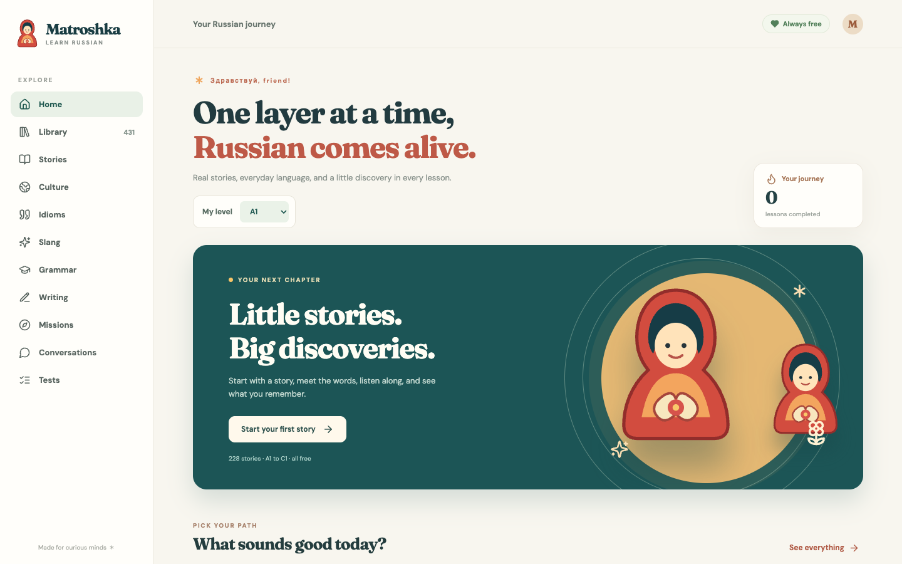
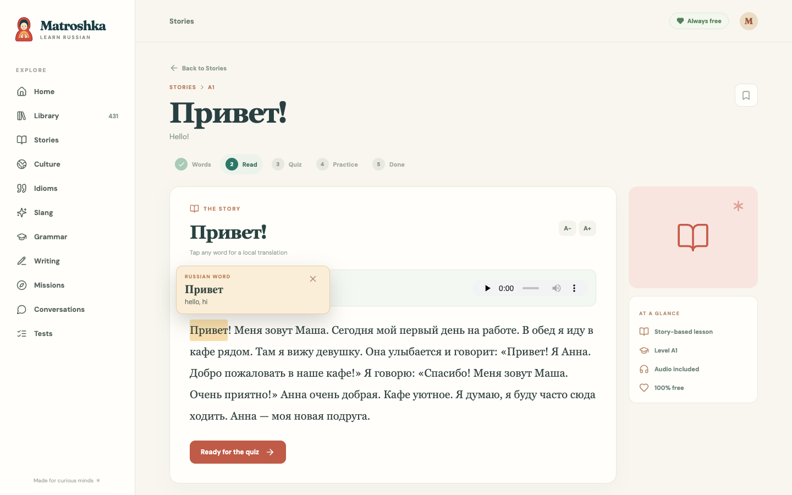
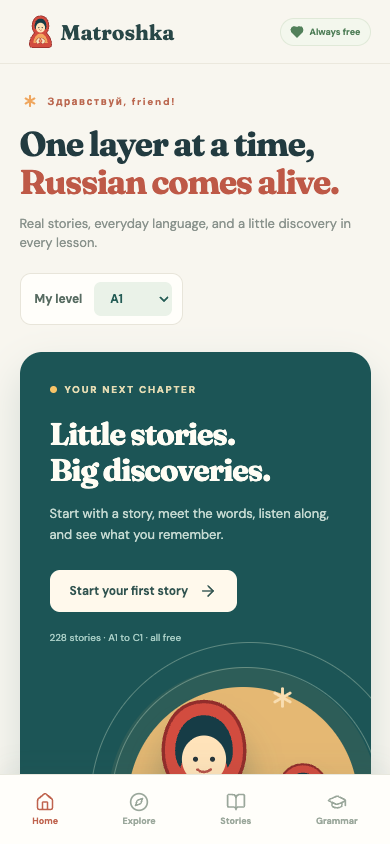

<div align="center">
  
  <h1>Matroshka</h1>
  <p><strong>Get past the beginner plateau, one story at a time.</strong></p>
  <p>Real Russian stories · Everyday expressions · A place to keep learning for free</p>
</div>

<p align="center">
  
</p>

## Why I made Matroshka

I created Matroshka for people who have taken beginner Russian courses and then found themselves stuck. You know the basics, but it can be hard to find material that helps you move beyond textbook phrases and actually feel at home in the language.

I also got tired of seeing every useful tutor platform placed behind a paywall. Learning Russian should not depend on a subscription, so **Matroshka is 100% free**. There is no account to create, no lesson to unlock, and no paid tier waiting after the first few stories.

The stories were written with a real Russian tutor. The slang and idioms are real expressions native Russian speakers use in everyday conversation. I wanted a place where learners could meet the language as people actually speak it, with enough context and practice to make it stick.

## What you can do

| | |
| --- | --- |
| **Read real stories** | Explore 228 stories from A1 through C1, with important words before reading and a quiz afterward. |
| **Learn words in context** | Tap a word in a story to see its translation right above it. Listen along when audio is available. |
| **Sound more natural** | Browse everyday slang, idioms, and culture lessons alongside grammar and writing practice. |
| **Follow your level** | Set your level on the dashboard. Library sections open with lessons for that level, and you can change the filter at any time. |
| **Keep your place** | Bookmark lessons and track progress in your browser. |

There are **1,556 lessons** in the library, including stories, grammar, missions, conversations, writing, culture, slang, and idioms.

## How a story works

1. **Meet the words.** Learn the vocabulary that matters before you read.
2. **Read and listen.** Follow the story, play its audio when available, and tap unfamiliar words for a quick definition.
3. **Check your understanding.** Answer questions about what happened.
4. **Practice a little more.** Some stories include extra exercises to help the lesson stay with you.

<p align="center">
  
</p>

<p align="center">
  
</p>

## Free and private by design

The app serves its lessons and audio as static files. Your level, bookmarks, drafts, and completed lessons are saved in your browser. There is no backend, account, payment system, or required API key. Guided conversations and missions offer prompts and hints for self-practice; they do not generate live AI replies. Browser progress stays on that device and does not sync across devices.

## Run it locally

You need Node.js 20 or newer.

```bash
git clone https://github.com/artiomcovali/matroshka.git
cd matroshka
npm ci
npm run dev
```

Open the local address printed by Vite. The repository already includes the lesson data and audio.

To make a production build:

```bash
npm run build
npm run preview
```

Vite writes the static site to `dist/`. To deploy on Vercel, import this GitHub repository, choose the **Vite** preset, and use `npm run build` with `dist` as the output directory. No environment variables are needed.

---

<p align="center"><strong>Keep opening the next layer. The language gets richer from here.</strong></p>
